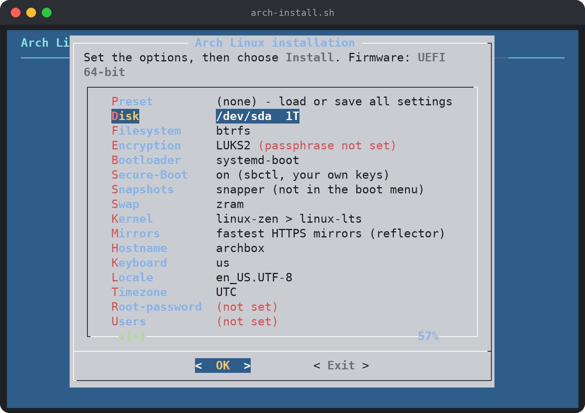
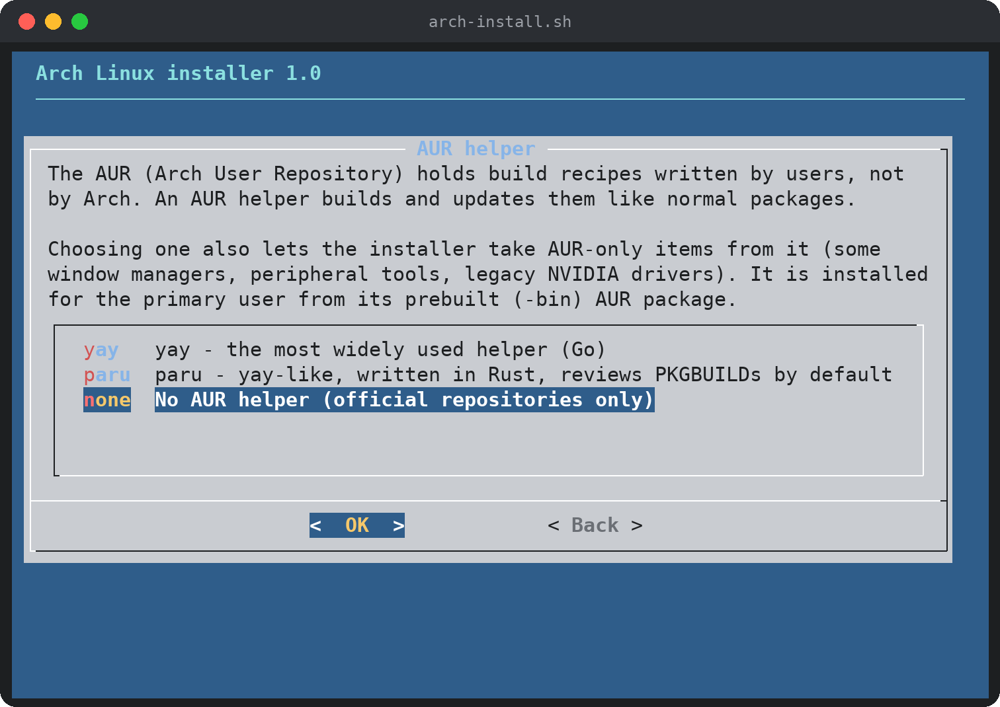
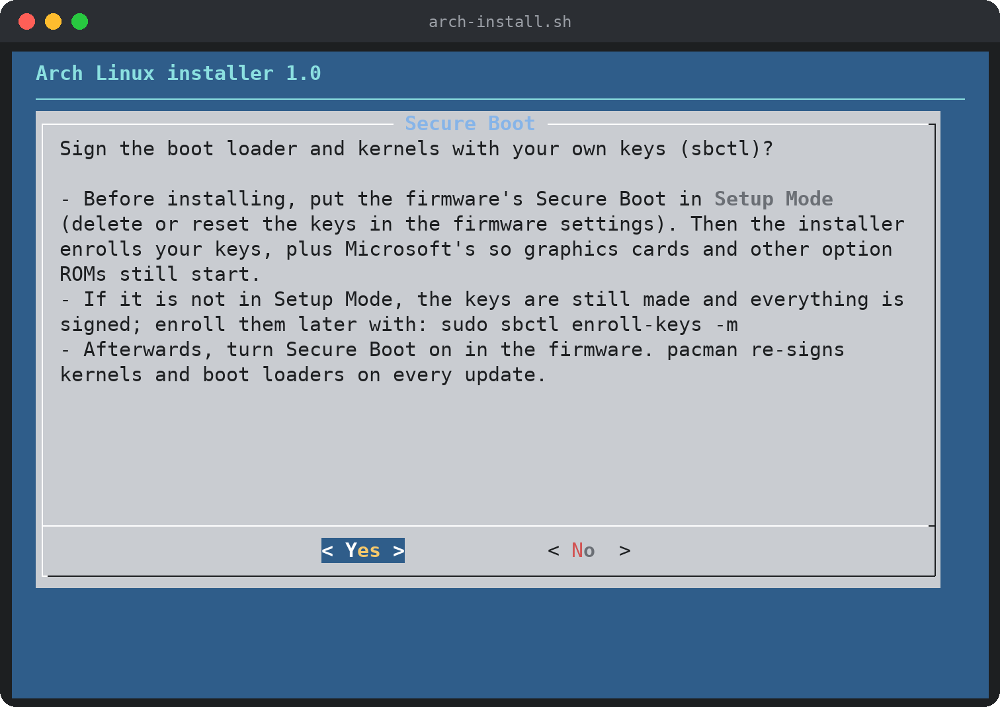
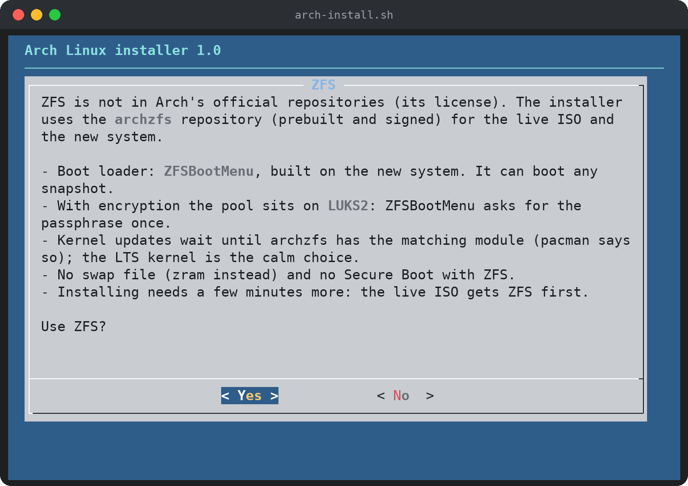
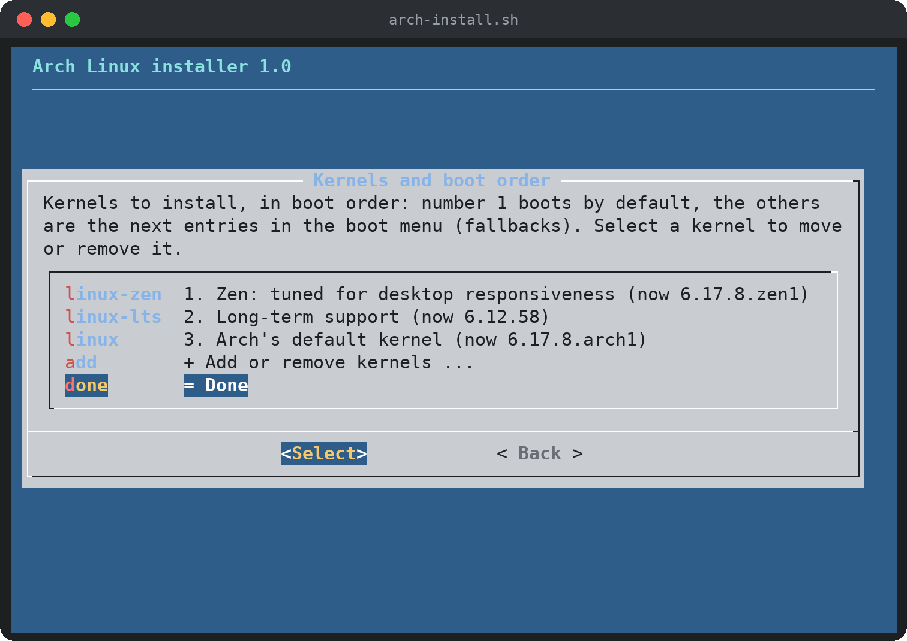

<div align="center">

# arch-install

**A menu-driven installer for [Arch Linux](https://archlinux.org).**
One script, one disk, a full system: encryption, Secure Boot, snapshots,
ZFS, your choice of boot loader, desktops or window managers, and popular
dotfiles.

[](LICENSE)




</div>

> [!WARNING]
> **The disk you select is erased completely.** There is no dual-boot mode.
> Back up anything you need first.

> [!NOTE]
> Version 1.0 is new. It is a port of
> [void-install](https://github.com/aranmi-git/void-install) and has been
> checked with a simulated install only, **not yet on real hardware**. Try it
> in a virtual machine first, and please report what you find.

## Quick start

Boot the official [Arch Linux ISO](https://archlinux.org/download/), get
online (`iwctl` for Wi-Fi), then:

```sh
curl -LO https://raw.githubusercontent.com/aranmi-git/arch-install/main/arch-install.sh
bash arch-install.sh
```

Set the options in the menu and choose **Install**. Only four items are
required: the disk, the root password, a user, and (if you encrypt) a
passphrase. Everything else has a sensible default.

Or start from a preset and answer only the disk, passwords and users:

```sh
bash arch-install.sh --preset hyprland-cachyos
```

The full guide is in the [manual (PDF)](docs/arch-install-manual.pdf).

## What it can do

| | |
|---|---|
| **Firmware** | UEFI (64-bit or 32-bit) and legacy BIOS, on GPT |
| **Filesystem** | ext4, btrfs with subvolumes (`@`, `@home`, `@snapshots`, ...), or **ZFS** (archzfs) |
| **Snapshots** | btrfs: snapper before and after every pacman transaction, plus hourly, bootable from GRUB. ZFS: before every pacman transaction, bootable from ZFSBootMenu |
| **Encryption** | none, LUKS1 or LUKS2 on the root partition (systemd `sd-encrypt`); ZFS sits on LUKS2 |
| **Secure Boot** | your own keys with sbctl; everything signed and re-signed on updates |
| **Boot loader** | GRUB, Limine, systemd-boot, rEFInd, UKI, EFISTUB, SYSLINUX/EXTLINUX; ZFSBootMenu for ZFS |
| **Kernels** | linux, linux-lts, linux-zen, linux-hardened, in the boot order you choose |
| **Swap** | zram (zram-generator), swap file, or none |
| **Desktops** | KDE Plasma, GNOME, Xfce, COSMIC, Cinnamon, MATE, LXQt, Budgie, Enlightenment |
| **Window managers** | Hyprland, Sway, niri, river, labwc, Wayfire, i3, bspwm, dwm, awesome, Qtile, herbstluftwm, Openbox, Fluxbox, IceWM, spectrwm, LeftWM |
| **Login screen** | SDDM, GDM, LightDM, Ly, greetd + tuigreet, COSMIC greeter, or none |
| **Dotfiles** | 21 presets: CachyOS (incl. Hyprland), EndeavourOS, Garuda, LARBS, gh0stzk, Chris Titus |
| **Graphics** | Intel, AMD, NVIDIA (open module; legacy 580xx/470xx from the AUR), virtual machines |
| **Software** | common applications, Steam / Wine / Lutris with multilib, Flatpak |
| **Peripherals** | Logitech, Corsair (OpenLinkHub or ckb-next), Razer, RGB, fans, controllers, wheels, tablets, Bluetooth, key remappers |
| **AUR** | yay or paru, your choice; AUR packages and AUR-only items |
| **Users** | several users, each with a sudo level |
| **Presets** | install the same system again with a few answers; fingerprint-checked IDs |
| **Extras** | LARBS-style bootstrap from a programs list (LARBS's own `progs.csv` works) |

## Packages: official first, then the AUR

Every package is taken from Arch's official repositories when it is there.
Packages that are only in the AUR are built with your AUR helper (yay or
paru), so they update with the rest of the system. Without an AUR helper they
are listed before the install starts and skipped.

<div align="center">


</div>

The helper is installed for the primary user from its prebuilt AUR package
(`yay-bin` or `paru-bin`). If aur.archlinux.org does not answer, Arch's
official GitHub mirror of the AUR is used.

## Secure Boot

With **Secure-Boot** on, the installer creates your own keys with sbctl and
signs the boot loader and kernels (or the unified kernel images). Put the
firmware's Secure Boot in **Setup Mode** before installing, and the keys are
enrolled too, together with Microsoft's so that graphics cards and other
option ROMs still start. Otherwise enroll them later with
`sudo sbctl enroll-keys -m`. Then turn Secure Boot on in the firmware.

It works with systemd-boot, UKI, EFISTUB, rEFInd and GRUB. The strongest
chain is **UKI**: the firmware checks one signed file that holds the kernel,
the initramfs and the command line. With GRUB, the firmware checks GRUB but
GRUB does not check the kernel.

## Snapshots

On btrfs, **Snapshots** sets up snapper on the `@snapshots` subvolume:

- one snapshot before and one after every pacman transaction (snap-pac)
- hourly snapshots, the last 5 hourly and 7 daily kept
- with GRUB, a "snapshots" submenu (grub-btrfs) to boot an older state

`/home` is a separate subvolume and is not rolled back.

## ZFS

<div align="center">

</div>

Choose **zfs** in the Filesystem item (64-bit UEFI only). ZFS is not in Arch's
official repositories, so the installer uses the signed
[archzfs](https://github.com/archzfs/archzfs) repository. Its key's
fingerprint (`3A9917BF0DED5C13F69AC68FABEC0A1208037BE9`) is checked before
pacman trusts it.

- **Live ISO**: the prebuilt module when it matches the ISO's kernel,
  otherwise `zfs-dkms` with that kernel's headers from the Arch Linux Archive.
- **Pool** `zroot` on the root partition, or on **LUKS2** with encryption:
  `zroot/ROOT/arch` holds `/` and `/boot` (kernels are part of every
  snapshot), `zroot/home`, `zroot/var/log` and `zroot/var/cache/pacman` are
  separate. lz4 compression, POSIX ACLs.
- **ZFSBootMenu** boots it: built on the new system from its pinned 3.1.0
  release, with mkinitcpio. Its release images cannot unlock LUKS; the local
  build can. It asks for the passphrase once, lists the boot environments and
  their snapshots, and starts the kernel. The system's own initramfs unlocks
  the disk a second time with a key file that lies inside the encrypted
  pool. The ZFSBootMenu image on the unencrypted EFI partition holds no key,
  and the installer checks that.
- **Modules** for each kernel: prebuilt when archzfs has the installed
  kernel's version, otherwise `zfs-dkms`. The LTS kernel is suggested:
  a prebuilt module pins its kernel version, so `pacman -Syu` waits until
  archzfs catches up with a new kernel, and LTS updates least often.
- **Snapshots**: `zroot/ROOT/arch@install` after installing, and with
  Snapshots on, one before every pacman transaction (the newest 10 kept). In
  ZFSBootMenu, select the boot environment and press Ctrl-S to boot one.
- No swap file (zram instead) and no Secure Boot: ZFSBootMenu starts the
  kernel with kexec, which the firmware does not check.

## Kernels and boot order

<div align="center">

</div>

Install any combination of Arch's kernels and put them in the order you want:
the first boots by default, the others are the next entries in the boot menu.
A pacman hook rewrites the menu whenever a kernel is installed or removed.
Change the order later in `/etc/default/kernel-order`, then run
`sudo update-boot-menu` (or `sudo grub-mkconfig -o /boot/grub/grub.cfg`,
or `sudo update-limine`).

## Peripherals

| Devices | Tools |
|---|---|
| Logitech | Solaar, logiops (service), g810-led, OpenLogi |
| Corsair | OpenLinkHub (service, web UI on port 27003) **or** ckb-next (service) |
| Razer | OpenRazer + Polychromatic |
| Gaming mice | Piper |
| RGB, fans | OpenRGB, CoolerControl (service) |
| Controllers, wheels | xone, xpadneo, controller access rules, SC Controller, AntiMicroX, Oversteer |
| Other | Bluetooth (service), Wacom tablets, input-remapper (service), keyd (service), kanata |

OpenLinkHub and ckb-next drive the same Corsair devices, so the menu lets you
pick one and explains the difference. With an AUR helper, OpenLinkHub and
OpenLogi come from the AUR; without one, from pinned, checksum-verified
releases.

## Presets

A preset is a small text file with every setting except the disk, the
passwords and the users. Save one from the **Preset** menu item, then load it
on any computer: `--preset <name>` (from [`presets/`](presets)),
`--preset <file>` or `--preset <https link>`. Add the `@...` part of its ID
and a changed preset is refused. A preset never holds passwords, and a file
that looks like it does is refused. Each install also leaves its settings in
`/root/arch-install.preset`.

| Name | ID | What it installs |
|---|---|---|
| `minimal` | `minimal@007f60d1dd06aa5f` | console server: LTS kernel first, systemd-networkd, SSH |
| `kde-desktop` | `kde-desktop@af5da80607e03341` | KDE Plasma, btrfs + snapshots, yay |
| `hyprland-cachyos` | `hyprland-cachyos@cebeb105fd605aea` | Hyprland with CachyOS's settings, btrfs + snapshots, yay |
| `i3-cachyos` | `i3-cachyos@3510e5580817ad80` | i3 with CachyOS's settings, btrfs + snapshots, paru |
| `gaming-kde` | `gaming-kde@190f075a2dd56ce0` | KDE, linux-zen, Steam, Wine, Lutris, GameMode, controllers |
| `secure-gnome` | `secure-gnome@ca58c00b72d8b8b4` | GNOME, unified kernel images, Secure Boot |
| `zfs-plasma` | `zfs-plasma@aa4dbdcbc6470c21` | KDE Plasma on ZFS, ZFSBootMenu, LTS kernel, ZFS snapshots |

All use LUKS2 encryption; change anything in the menu after loading.

## After installing

Run the same script on the installed system to add users, programs or
dotfiles later:

```sh
sudo bash arch-install.sh --bootstrap
```

Other options: `--preset`, `--help`, `--version`.

## Project status

Version 1.0. Lint-clean, and tested with a simulated install of every boot
loader (GRUB, Limine, systemd-boot, rEFInd, UKI, EFISTUB, SYSLINUX,
ZFSBootMenu; UEFI and BIOS), Secure Boot, snapper, ZFS, the AUR paths and
presets: about 530 automated checks. **Nothing has been installed on real hardware or in a virtual machine
yet.** See the [changelog](CHANGELOG.md) for exactly what was and was not
tested.

## Contributing

Bug reports and pull requests are welcome. When reporting a failed install,
attach `/tmp/arch-install.log` from the live system. Passwords are never
written to it, and credentials inside URLs are masked.

## License

[GNU General Public License, version 2](LICENSE). This program comes with
no warranty.

The dotfile presets are downloaded from their own repositories at install
time and remain under their authors' licenses; none are included here.
AUR packages are built from their own recipes, written by their maintainers.
